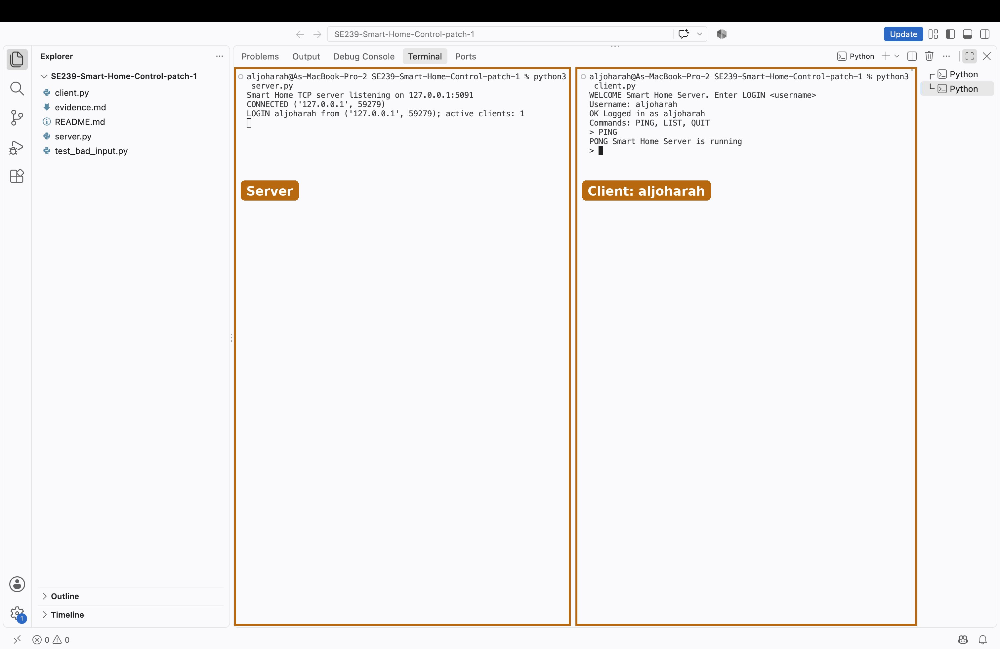
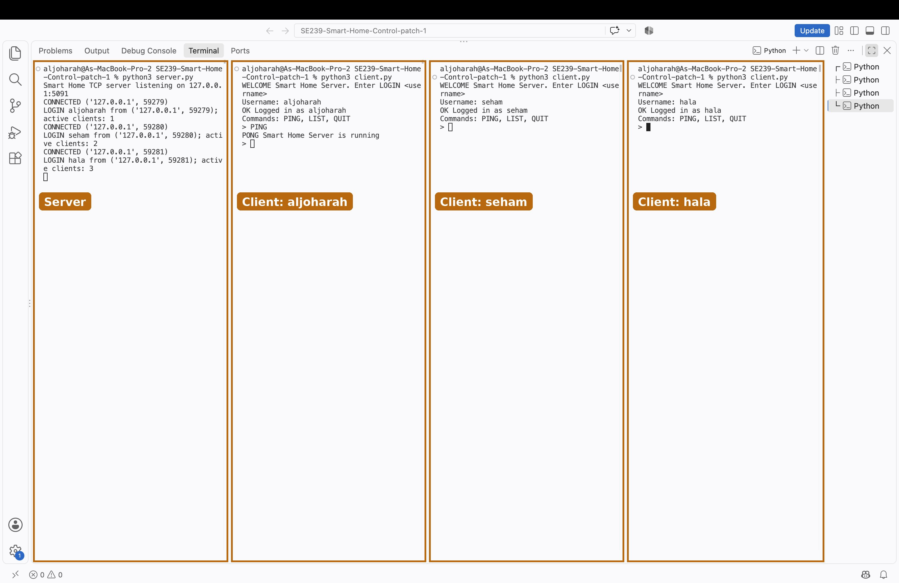
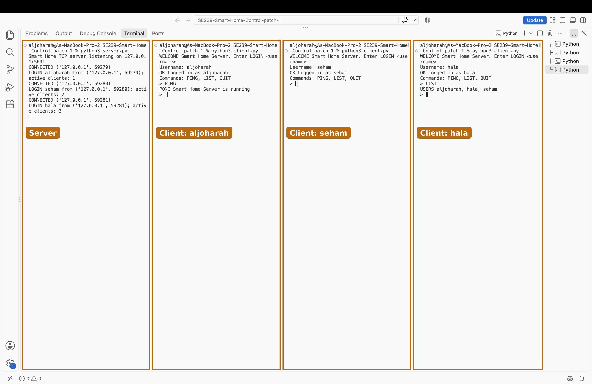

# Deliverable 2 — Evidence Notes

**Course:** SE239 Network Programming  
**Topic:** 2.9 Simple Smart-Home Control  
**Team members:** Seham Alattar, Hala Almadi, Moudhi Aljabr, Aljoharah Almajhad  
**Git repository:** https://github.com/sihamalattar/SE239-Smart-Home-Control

## Integration fix before testing
`server.py` failed to start with an `IndentationError` (line 53, the `except` clause was indented with 3 spaces instead of 4). Fixed in pull request #1. All evidence below was captured with this fix applied.

## Week 6 — First connection working
**Test:** Start `server.py`, run `client.py`, log in, send `PING`.

**Expected:** Server accepts the connection, client receives `OK Logged in as ...` and `PONG Smart Home Server is running`.

**Actual result:** Passed. The server printed `CONNECTED` and `LOGIN aljoharah ...; active clients: 1`. The client received `OK Logged in as aljoharah`, then `PONG Smart Home Server is running` after `PING`.

**Screenshot:**

## Week 8 — Three simultaneous clients and login
**Test:** Keep three separate client terminals connected with different usernames, then send `LIST` from one client.

**Expected:** All three clients log in successfully, server remains active, and `LIST` shows all three usernames.

**Actual result:** Passed. Three clients (aljoharah, seham, hala) logged in at the same time and the server reported `active clients: 3`. `LIST` sent from the hala client returned `USERS aljoharah, hala, seham`.

**Screenshots:**

## Team contributions
- Seham Alattar — Server setup — [commit link]
- Hala Almadi — Client and login — [commit link]
- Moudhi Aljabr — Concurrent client handling — [commit link]
- Aljoharah Almajhad — Testing, documentation, integration (server start-up fix, test runs, evidence) — https://github.com/sihamalattar/SE239-Smart-Home-Control/pull/1
